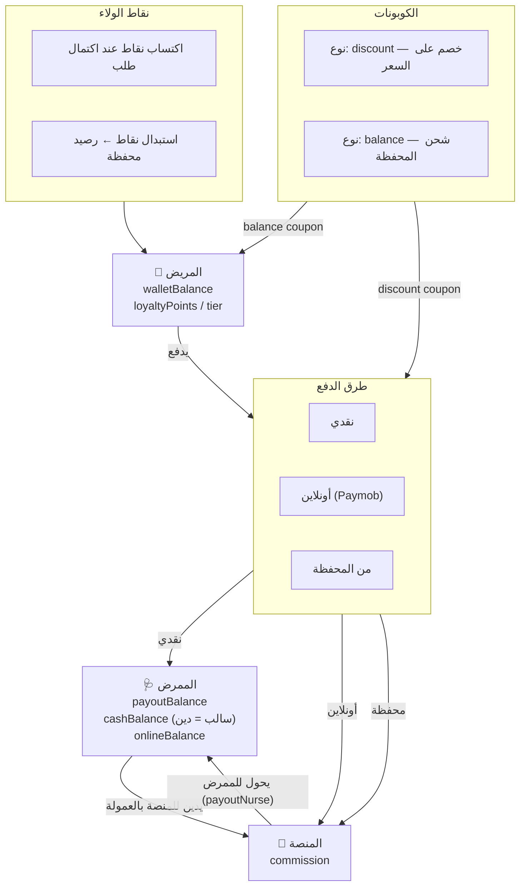

# 🏦 تقرير تدقيق النظام المالي — Cure App

## خريطة التدفق المالي



---

## 1. ✅ ما يعمل بشكل صحيح

### المحفظة (Patient Wallet)
| الميزة | الحالة |
|---|---|
| شحن بالبطاقة (Paymob → `deposit()`) | ✅ يعمل داخل Firestore Transaction |
| شحن بكوبون `balance` (`redeemVoucher()`) | ✅ يعمل داخل Firestore Transaction |
| دفع طلب من المحفظة (`payOrderWithWallet()`) | ✅ Atomic + Idempotency Guard |
| عرض السجل في `PatientWalletScreen` | ✅ |
| إخفاء الرصيد (العين) | ✅ |

### الكوبونات (Coupons)
| الميزة | الحالة |
|---|---|
| تطبيق كوبون خصم (`discount`) على السلة | ✅ عبر `DiscountService.applyCoupon()` |
| تطبيق كوبون رصيد (`balance`) على المحفظة | ✅ عبر `FinancialService.redeemVoucher()` |
| التحقق من: الصلاحية، الحد الأدنى للطلب، الانتهاء | ✅ |
| منع إعادة الاستخدام (maxUsesPerUser) | ✅ |
| حساب الخصم (نسبة % أو مبلغ ثابت) | ✅ |

### الممرض (Nurse Finances)
| الميزة | الحالة |
|---|---|
| زيادة مديونية الممرض على الطلب النقدي | ✅ `cashBalance` يصبح سالب |
| إضافة رصيد للممرض عند الطلب الأونلاين | ✅ `onlineBalance` يزيد |
| تسوية يدوية من الأدمن (`settleNurseBalance`) | ✅ |
| تحويل أرباح (`payoutNurse`) | ✅ مع خصم الدين الاختياري |
| نقاط الولاء لتحفيز الطلبات | ✅ |

---

## 2. ⚠️ مشاكل موجودة تحتاج إصلاح

### 🔴 مشكلة 1 — الكوبون نوع `discount` لا يُسجَّل في قاعدة البيانات
**الملف:** [`discount_service.dart`](file:///c:/Users/eslam/curee/lib/services/discount_service.dart) + [`cart_provider.dart`](file:///c:/Users/eslam/curee/lib/providers/cart_provider.dart)

**المشكلة:** عند تطبيق كوبون خصم على السلة، يتم احتساب الخصم محلياً في `CartProvider` ويُرفق بالطلب كـ `couponCode`، لكن **لا يتم**:
1. تحديث `usedCount` في Firestore
2. إضافة `userId` إلى `usedByUsers` في مستند الكوبون

هذا يسمح للمستخدم بإعادة استخدام نفس كوبون الخصم لا نهائياً.

**الحل المطلوب:** إضافة استدعاء تحديث الكوبون عند إتمام الطلب في `FinancialService.processCompletedOrder()` أو في Cloud Function.

---

### 🔴 مشكلة 2 — `balanceBefore` / `balanceAfter` غير دقيقين في كوبون المحفظة
**الملف:** [`financial_service.dart`](file:///c:/Users/eslam/curee/lib/services/financial/financial_service.dart) — السطر ~652

**الكود:**
```dart
balanceBefore: 0, // Not querying user here for speed, can be improved
balanceAfter: 0, 
```

**المشكلة:** هذان الحقلان يُسجَّلان بـ `0` دائماً في سجل الكوبون، مما يكسر المراجعة المالية. القيم الصحيحة متاحة بسهولة لأن العملية تجري داخل Firestore Transaction.

**الحل:** قراءة `walletBalance` من مستند المستخدم داخل نفس الـ Transaction وتمريرها.

---

### 🟡 مشكلة 3 — `DiscountService` لا يتحقق من نوع الكوبون
**الملف:** [`discount_service.dart`](file:///c:/Users/eslam/curee/lib/services/discount_service.dart)

**المشكلة:** `applyCoupon()` لا يتحقق من `coupon.type`. إذا أدخل مستخدم كوبون من نوع `balance` في السلة (بدلاً من المحفظة)، يحاول تطبيقه كخصم دون أي رسالة خطأ.

**الحل:** إضافة تحقق:
```dart
if (coupon.type == 'balance') {
  throw Exception('هذا الكوبون مخصص لشحن المحفظة فقط. استخدمه من قسم المحفظة.');
}
```

---

### 🟡 مشكلة 4 — نقاط الولاء تُحسَب على السعر قبل الخصم
**الملف:** [`financial_service.dart`](file:///c:/Users/eslam/curee/lib/services/financial/financial_service.dart) — `_triggerRewards()`

```dart
await _rewardsEngine.processOrderRewards(
  orderAmount: totalAmount, // هذا السعر الكلي بعد العمولة
```

**المشكلة:** إذا كان الطلب بخصم كبير، يحصل المريض على نقاط أعلى من المبلغ الذي دفعه فعلياً. يجب حساب النقاط على `finalPrice` لا `total`.

---

### 🟡 مشكلة 5 — نموذجان مكررّان للمعاملة المالية
توجد **نموذجان**:
- [`financial_transaction.dart`](file:///c:/Users/eslam/curee/lib/models/financial_transaction.dart) — النموذج الجديد الكامل ✅
- [`transaction_model.dart`](file:///c:/Users/eslam/curee/lib/models/transaction_model.dart) — نموذج قديم مبسط

**المشكلة:** وجود النموذجين يسبب ارتباكاً. شاشة `TransactionHistory` قد تستخدم نموذجاً مختلفاً عن `PatientWalletScreen`. يجب توحيدهما.

---

### 🟡 مشكلة 6 — `validateCouponCode` مكرّرة في 3 أماكن
نفس الدالة موجودة في:
- `firestore_service.dart` (السطر 182)
- `firestore/payment_firestore_service.dart` (السطر 114)
- `firestore/coupon_firestore_service.dart` (السطر 21)

مما يعني أي تعديل في منطق التحقق يجب أن يُطبق 3 مرات.

---

## 3. 🗺️ خريطة الكوبونات التفصيلية

```
نوع 'discount':
   DiscountService.applyCoupon()
   → CartProvider.applyCouponCode()
   → يُخزَّن في _appliedCouponCode
   → يُرفق بالطلب كـ couponCode
   ❌ لا يُحدَّث في Firestore عند الطلب

نوع 'balance':
   FinancialService.redeemVoucher()
   → يُحدَّث usedCount و usedByUsers في Firestore ✅
   → يزيد walletBalance في Firestore ✅
   → يسجل FinancialTransaction ✅ (لكن balanceBefore=0 ❌)
```

---

## 4. 🗺️ خريطة رصيد الممرض التفصيلية

```
cashBalance  (سالب = مديون للمنصة):
  ينقص عند: طلب نقدي مكتمل (الممرض استلم النقود)
  يزيد عند: settleNurseBalance (دفع المديونية)
            payoutNurse (إذا deductDebt=true)

onlineBalance (موجب = أرباح إلكترونية):
  يزيد عند: طلب أونلاين مكتمل (المنصة تحوّل للممرض)
  ينقص عند: payoutNurse

payoutBalance = cashBalance + onlineBalance (الإجمالي)
```

---

## 5. توصيات الإصلاح المقترحة (بالأولوية)

| الأولوية | المشكلة | الملف المتأثر |
|---|---|---|
| 🔴 عاجل | تحديث الكوبون عند استخدامه في السلة | `discount_service.dart` |
| 🔴 عاجل | إصلاح `balanceBefore/After=0` في كوبون المحفظة | `financial_service.dart:652` |
| 🟡 مهم | التحقق من نوع الكوبون قبل التطبيق | `discount_service.dart` |
| 🟡 مهم | حساب نقاط الولاء على `finalPrice` | `financial_service.dart:_triggerRewards` |
| 🟡 تنظيم | دمج `transaction_model.dart` مع `financial_transaction.dart` | — |
| 🟡 تنظيم | توحيد `validateCouponCode` في مكان واحد | `coupon_firestore_service.dart` |
